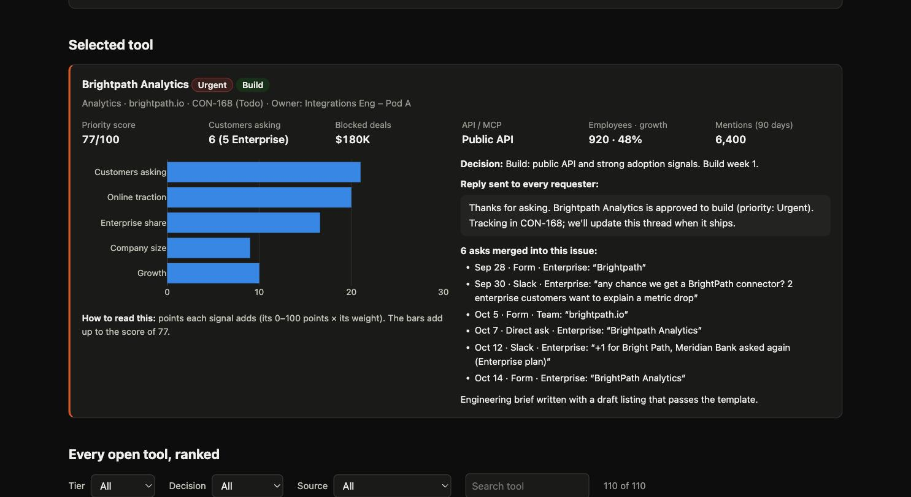

# Connector & Skills Command Center

**Designed and built by Bharat with AI.** I defined the problem, the scoring approach and every operating decision, and reviewed every number; Claude Code (Anthropic's AI coding assistant) wrote the code alongside me, step by step, with a commit after each step.

Demand for integration connectors and open-source agent skills grows faster than ad-hoc triage can handle: the same tool is asked for five ways in three channels, the backlog fills with issues nobody owns, trending skills get spotted late, and listings drift apart as the catalog grows.
This project is a working command center that turns all of it into one weekly, measurable cycle. Every ask is matched, deduped, scored with a simple weighted average, and given an owner, a decision and a reply. Trending skills are ranked, cleared through five compliance gates, ported to SKILL.md, tested and launched. Every listing is held to one template.

**Live demo:** https://bharat-analyst.github.io/connector-skills-command-center/



## Role responsibility → page

| Responsibility | What we built | Page |
|---|---|---|
| Weekly triage | One queue from form, request channel and direct asks; spellings matched; deduped against the live catalog and Linear | Intake & triage |
| Research & scoring | Weighted average of five signals → Urgent / High / Medium / Low rubric, backtested on past launches | Intake & triage |
| Backlog management | Owner, decision (build / partner / decline / need info) and reply on every ask; Linear import CSV | Intake & triage |
| Escalations & reporting | Product Lead escalations, engineering build briefs, weekly written status | Intake · Weekly status |
| Trend spotting | Candidates from GitHub, X and communities ranked by a fitted installs model | Skill ports |
| Qualification & compliance | License, creator permission, attribution, remote transport, sandbox gates | Skill ports |
| Porting, publishing, launch | SKILL.md package, listing copy, QA log, GitHub export workflow, launch calendar | Skill ports |
| Listing consistency | Template as eight checks, full catalog audit, high-traffic rewrites, pre-launch checklist | Listings |
| First-party plugins (future) | Same SKILL.md, QA and listing path | Skill ports |
| 90-day success metrics | SLA, owner / decision / reply coverage, cadence, attribution, audit coverage | Weekly status |

Three worked examples run through the site: ranked triage of connector requests (Intake), a port plan for a trending skill (sketchwright on Skill ports), and two listing rewrites (Granite Docs and Chartcraft on Listings).

## How the scoring works

- **Connector priority score (0–100)** = a weighted average of five signals, each bucketed to 0–100 points: customers asking (30%), online traction (25%), Enterprise share (20%), company size (15%) and growth (10%). Brightpath Analytics: 21 + 20 + 16.6 + 9 + 10 = **77**. Backtested on 260 past launches, it picks the connectors that got used better than "most asks wins" (AUC **0.74** vs **0.62**). The two signals adding the most points are shown as its top reasons.
- **Rubric:** Urgent 65+ (or 50+ with a $100K+ blocked deal), High 50+, Medium 35+, Low below 35.
- **Decisions:** API unknown → Need info; vendor runs its own MCP server → Partner; no public API or Low → Decline; otherwise → Build, with a brief for Urgent and High.
- **Skill rank** = predicted 30-day installs from a regression on 90 past ports. Recent momentum (stars, X and community mentions in the last 7 days) dominates. Holdout rank correlation is **0.93**, against **0.48** for ranking by total stars.
- **Listing template:** eight checks a script can run. The top 20 listings by views × gap are rewritten first.

Every threshold lives once at the top of [`pipeline.py`](pipeline.py) and is explained on the **How this works** page ([`content/how_this_works.md`](content/how_this_works.md)), which also says what synthetic data can and can't show.

**Featured items:** Brightpath Analytics (Build, Urgent), Larkspur Payments (Partner), Pebblework Notes (Decline), an unnamed "HR tool" ask (Need info), sketchwright (ported and launched), bincrack (blocked), and the Granite Docs and Chartcraft listing rewrites. `pipeline.py` fails if any of them lands somewhere else.

## How it's built

```
generate_data.py  → data/raw/*.csv                  forms, Slack, direct asks, Linear backlog, live catalog, research
                                                     signals, past launches, skill candidates, outreach, QA runs,
                                                     listings (seed 42), messy on purpose
pipeline.py       → data/processed/*.csv            requests, tool scores, ranked skills, listing audit
                  → data/output/linear_import.csv   Linear import shape: one issue per tool
                  → data/output/briefs/*.md         engineering briefs for Urgent and High builds
                  → data/output/skills/<name>/      SKILL.md, listing.json, qa_log.md
                  → data/output/escalations.md, weekly_status_<date>.md, replies.csv
                  → docs/data/*.json, docs/files/   read by the site
validate.py       (last pipeline step) recomputes counts, SLA, every priority score,
                  rubric, decisions, launch gates and listing checks; fails loudly on any mismatch
docs/             static site (HTML/CSS/JS + Plotly.js), hosted on GitHub Pages
```

Python 3.11 + pandas + numpy. No database, no build tools.

### Run it

```bash
python3.11 -m venv .venv
.venv/bin/pip install -r requirements.txt
.venv/bin/python generate_data.py   # creates data/raw/*.csv
.venv/bin/python pipeline.py        # scores, decides, exports, validates
python3 -m http.server 8000 -d docs # then open http://localhost:8000
```

## Next steps with real data

1. **Backtest on real launch outcomes** (weekly active orgs per connector) each quarter and adjust the weights; move to a fitted model once there are enough launches.
2. **Pull intake from the real tools:** the form, the Slack channel via its API, and Linear's customer requests, instead of CSV extracts.
3. **Run the listing checks in CI** on the marketplace repo, so a failing listing blocks the merge.
4. **Track post-launch installs per port** to close the loop on the skills model.
